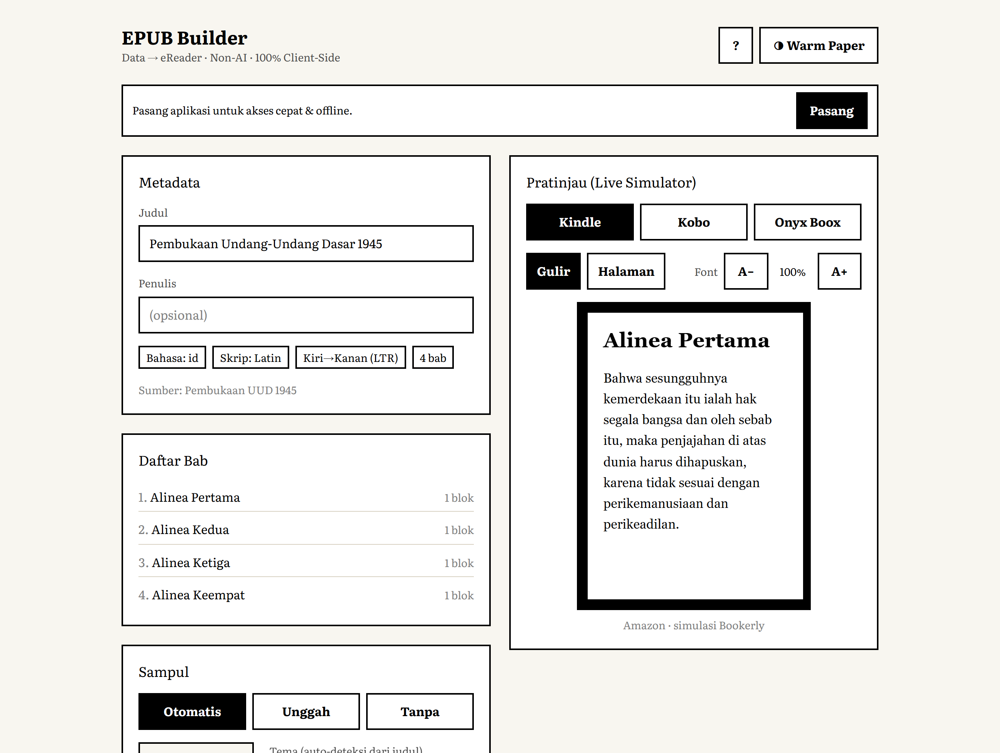
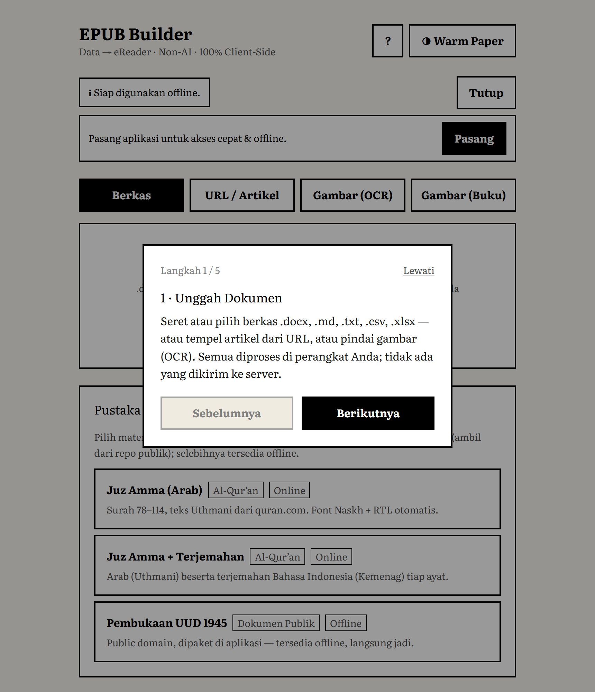
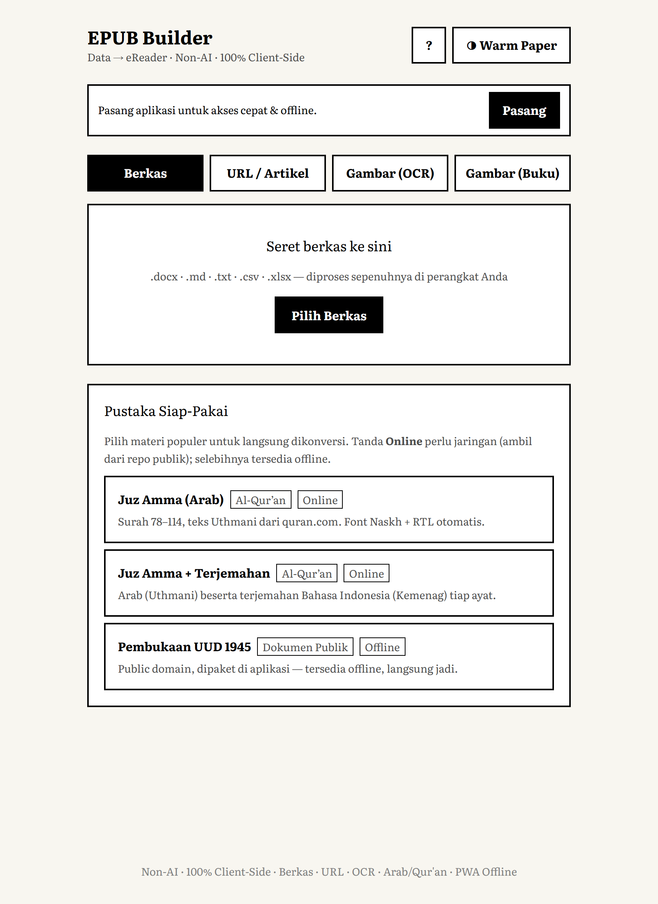
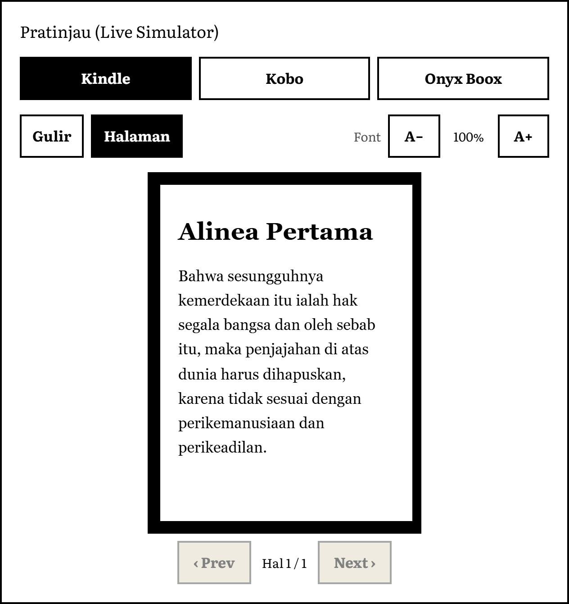

# EPUB Builder — Data to eReader (PWA)

Aplikasi **PWA 100% client-side, Non-AI, gratis** untuk mengubah dokumen
(`.docx`, `.md`, `.txt`, `.csv`, `.xlsx`, URL artikel, gambar/OCR) menjadi
**EPUB 3.0 valid** yang dioptimalkan untuk layar **E-Ink** (Kindle, Kobo,
Onyx Boox, Meebook), dengan dukungan penuh skrip **Arab/Qur'an (RTL + font embed)**.

> Status: **Lengkap & tervalidasi.** Mesin konversi (parsers · fonts · epub · cover),
> antarmuka E-Ink (Unggah → Metadata → Sampul → Build → Transfer) dengan **Dual-Pane**
> di tablet/PC, Live Simulator (**mode Gulir & Halaman/page-flip**) + Immersion Mode +
> onboarding, parser URL (Readability), OCR (Tesseract) & **Image-Book Mode** (buku
> berbasis gambar grayscale), **Custom Font Upload** (.ttf/.otf) & **font CJK
> on-demand** (Noto SC/JP/KR, unduh+subset saat build), **Inline SVG** untuk
> ligatur kaligrafi, **Pustaka siap-pakai** (Juz Amma via quran.com API, UUD 1945
> offline), **Kirim ke Kindle**, subsetting font HarfBuzz, dan PWA (offline · install ·
> Web Share · QR) — semua 100% client-side. EPUB hasil **lulus epubcheck resmi
> IDPF/W3C (0 error)**, termasuk EPUB Image-Book + SVG.

## Tampilan

Antarmuka **E-Ink serif** dengan **Dual-Pane** di tablet/PC — editor di kiri, **Live Simulator**
(Kindle/Kobo/Onyx, mode **Gulir** atau **Halaman**/page-flip) menempel di kanan:

<p align="center">
  
</p>

Di ponsel/eReader tampil satu kolom. Masukan lewat **Berkas / URL / OCR / Gambar (Buku)**, atau
**Pustaka Siap-Pakai** (Juz Amma via quran.com API, UUD 1945 offline):

| Onboarding | Masukan + Pustaka Siap-Pakai | Live Simulator (page-flip) |
|:---:|:---:|:---:|
|  |  |  |

## Prinsip Arsitektur

- **100% client-side** — tanpa backend; seluruh proses di RAM browser.
- **Ringan & instan** — target < 50MB RAM, < 1–2 detik per konversi.
- **Zero-Bloat CSS** — tanpa shadow/gradient/animasi (ramah E-Ink, anti-ghosting).
- **Non-AI** — parsing & deteksi bahasa berbasis library ringan + Unicode range.

## Tech Stack

Vite · React · TypeScript · Tailwind CSS (zero-bloat) · `vite-plugin-pwa` ·
JSZip · Mammoth · SheetJS · Marked · Readability · franc-min · Tesseract.js (lazy).

## Menjalankan

```bash
npm install
npm run dev        # mode pengembangan
npm run build      # build produksi (PWA)
npm run preview    # pratinjau hasil build
npm run typecheck  # pemeriksaan tipe
npm run smoke      # uji pipeline (parsers/fonts/epub/cover/subset)
npm run validate   # validasi konformansi EPUB (OCF/OPF/NAV, E-Ink, RTL) — inti epubcheck (tanpa Java)
npm run epubcheck  # validasi OTORITATIF via epubcheck resmi IDPF/W3C (butuh Java)
```

> `npm run epubcheck` membangun EPUB contoh (fixtures bersama dengan `validate`),
> mengunduh & meng-cache epubcheck.jar otomatis ke `.epubcheck-cache/`, lalu
> menjalankannya dengan Java sistem (PATH / `JAVA_HOME` / `EPUBCHECK_JAVA`).
> Dipakai di CI (`.github/workflows/ci.yml`, via `actions/setup-java`). Tanpa Java,
> pakai `npm run validate` yang mencakup aturan inti yang sama.

> `npm run validate` membangun EPUB nyata (Latin + Arab dengan font LPMQ ter-subset)
> lalu memeriksa aturan inti yang dipakai eReader (Kindle/Kobo/Onyx): `mimetype`
> STORED entri pertama, OPF/manifest/spine konsisten, XHTML well-formed, anchor TOC
> teresolusi, media-type font/cover, RTL, dan higiene CSS E-Ink. Bukan pengganti
> epubcheck resmi (butuh Java), tapi mencakup penyebab penolakan paling umum.

## Struktur `src/`

| Folder | Tanggung jawab | Fase |
|---|---|---|
| `core/` | IR dokumen, pipeline compiler, pre-flight check | 1 |
| `parsers/` | docx, md, csv/xlsx, url, ocr | 1 & 5 |
| `fonts/` | font builder RTL, subsetting, language detector | 2 |
| `epub/` | perakit JSZip, OPF/NAV/NCX, splitter, image pipeline | 3 |
| `cover/` | Canvas cover generator adaptif | 3 |
| `ui/` | komponen E-Ink, simulator (gulir/halaman), immersion, onboarding, dual-pane | 4 & 5 |
| `pwa/` | service worker, QR transfer, Send-to-Kindle | 6 |
| `presets/` | Pustaka siap-pakai: quran.com API (Juz Amma), UUD 1945 offline | — |
