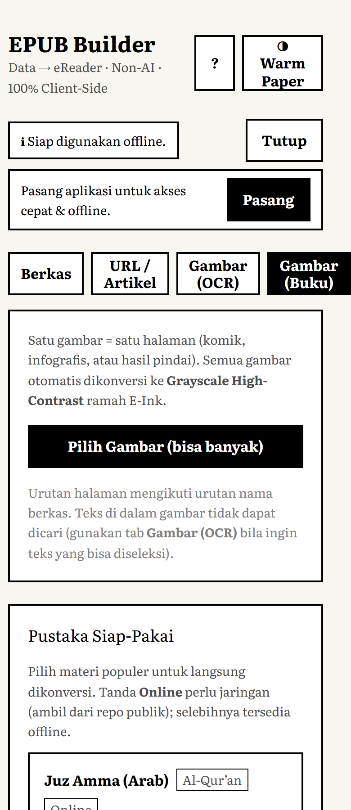
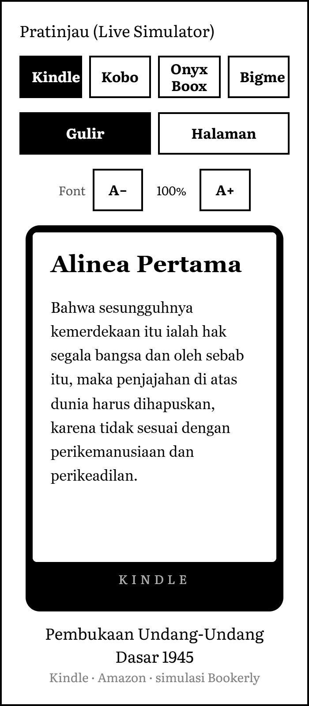
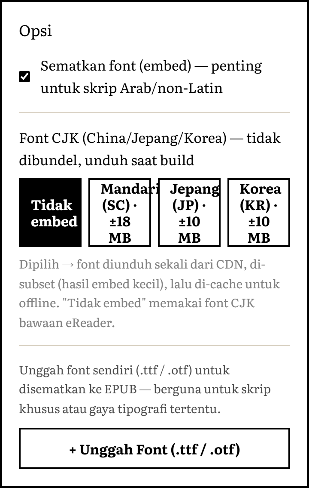
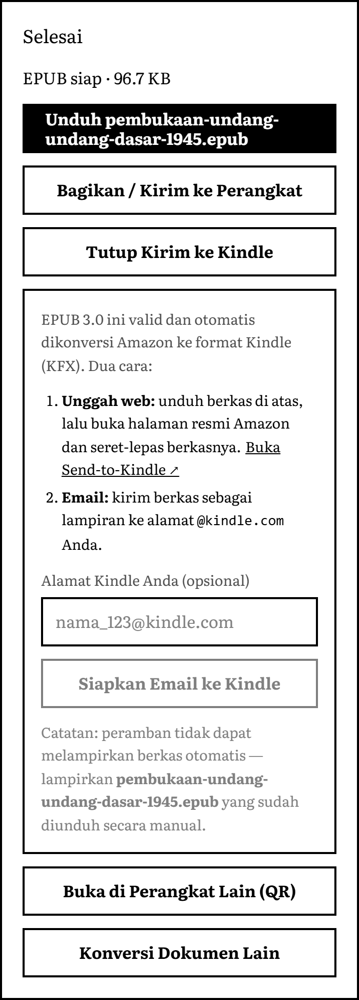
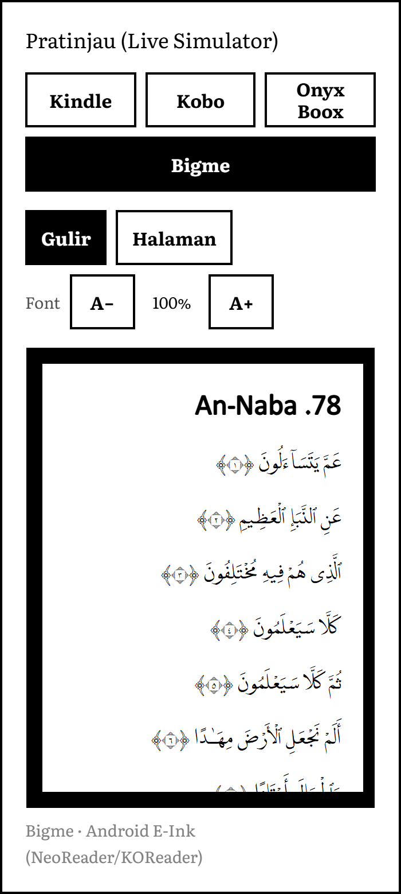
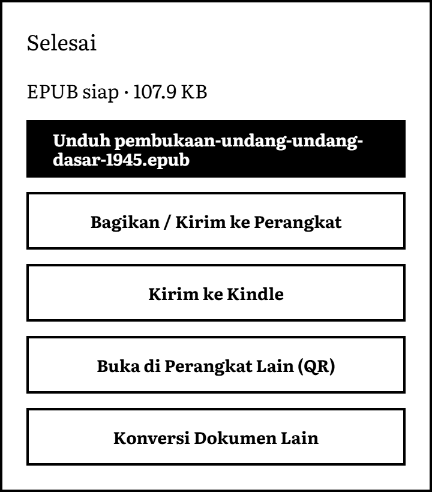
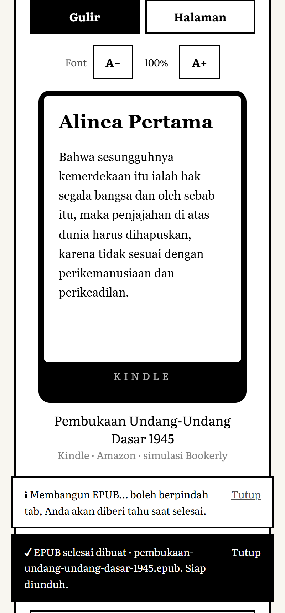
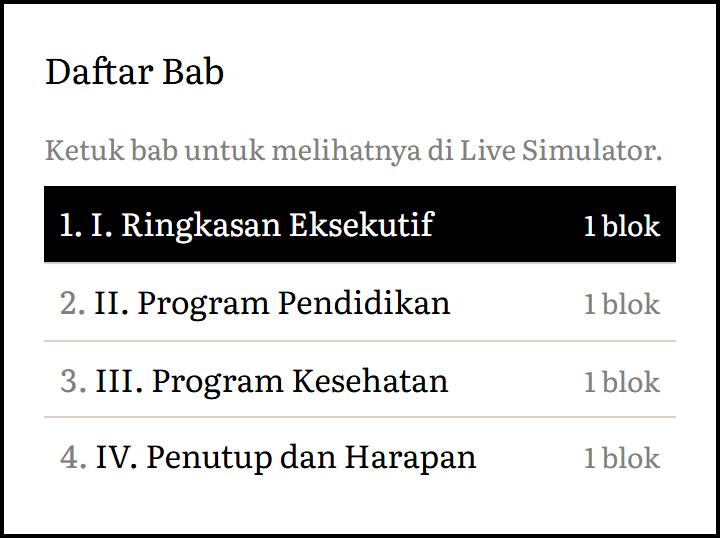
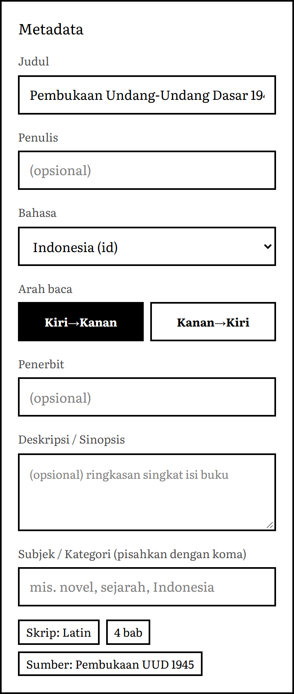
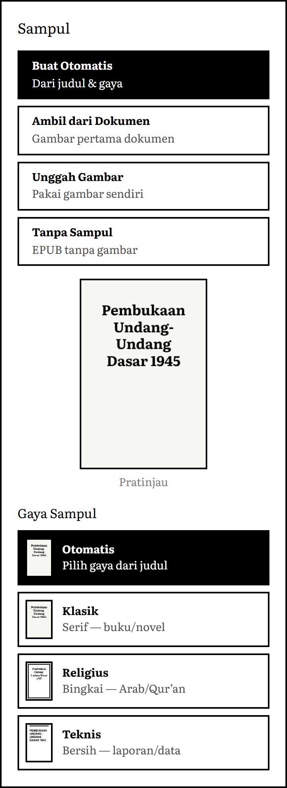

# EPUB Builder — Data to eReader (PWA)

Aplikasi **PWA 100% client-side, Non-AI, gratis** untuk mengubah dokumen
(`.docx`, `.md`, `.txt`, `.csv`, `.xlsx`, `.pdf`, URL artikel, gambar/OCR) menjadi
**EPUB 3.0 valid** yang dioptimalkan untuk layar **E-Ink** (Kindle, Kobo,
Onyx Boox, Meebook, **Bigme** & eReader Android lain), dengan dukungan penuh
skrip **Arab/Qur'an (RTL + font embed)**.

📄 [Product Brief](docs/BRIEF.md) · 📝 [Changelog](docs/CHANGELOG.md) · ⚠️ [Catatan Konversi (kondisi yang memengaruhi hasil, termasuk PDF)](docs/CATATAN-KONVERSI.md)

> Status: **Lengkap & tervalidasi.** Mesin konversi (parsers · fonts · epub · cover),
> antarmuka E-Ink (Unggah → Metadata → Sampul → Build → Transfer) dengan **Dual-Pane**
> di tablet/PC, Live Simulator (**mode Gulir & Halaman/page-flip**) + Immersion Mode +
> onboarding, parser URL (Readability), OCR (Tesseract) & **Image-Book Mode** (buku
> berbasis gambar grayscale), **Custom Font Upload** (.ttf/.otf) & **font CJK
> on-demand** (Noto SC/JP/KR, unduh+subset saat build), **Inline SVG** untuk
> ligatur kaligrafi, **Pustaka siap-pakai** (Juz Amma via quran.com API, UUD 1945
> offline), **Kirim ke Kindle**, subsetting font HarfBuzz, dan PWA (offline · install ·
> Web Share · QR) — semua 100% client-side. EPUB hasil **lulus epubcheck resmi
> IDPF/W3C (0 error)**, termasuk EPUB Image-Book + SVG.

## Tampilan

Antarmuka **E-Ink serif** dengan **Dual-Pane** di tablet/PC — editor di kiri, **Live Simulator**
(Kindle/Kobo/Onyx, mode **Gulir** atau **Halaman**/page-flip) menempel di kanan:

<p align="center">
  
</p>

Di ponsel/eReader tampil satu kolom. Masukan lewat **Berkas / URL / OCR / Gambar (Buku)**, atau
**Pustaka Siap-Pakai** (Juz Amma via quran.com API, UUD 1945 offline):

| Onboarding | Masukan + Pustaka Siap-Pakai | Live Simulator (page-flip) |
|:---:|:---:|:---:|
|  |  |  |

### Sorotan fitur — tampilan ponsel

Satu kolom, tombol besar ramah sentuh E-Ink; setiap fitur baru di layar HP:

| Image-Book Mode + 4 sumber masukan | Live Simulator · mode Halaman (page-flip) |
|:---:|:---:|
|  |  |
| **Font: CJK on-demand (SC/JP/KR) + Custom Upload** | **Build selesai → Kirim ke Kindle + QR** |
|  |  |

### Hasil ter-generate & kompatibilitas Android E-Ink (Bigme, Onyx, dll.)

Keluaran adalah **EPUB 3.0 standar yang lulus epubcheck resmi IDPF/W3C** — bukan format
khusus. Karena valid & reflowable, berkas yang sama terbaca di **eReader Android** seperti
**Bigme, Onyx Boox, Meebook, Boyue** lewat reader bawaan (NeoReader) atau aplikasi
(**KOReader, Moon+ Reader, ReadEra, Librera**), juga di Kobo dan — via Send-to-Kindle —
di Kindle. Font Arab/Qur'an **disematkan di dalam berkas** (OEBPS/fonts/ + `@font-face`),
jadi tampil benar walau perangkat tak punya fontnya. Di bawah: pratinjau WYSIWYG **file yang
ter-generate** (Juz Amma dari quran.com, teks Uthmani RTL) pada bingkai **Bigme/Android**, dan
berkas `.epub` siap unduh:

| Pratinjau file ter-generate — tab Bigme (Android E-Ink) | Berkas `.epub` siap diunduh/transfer |
|:---:|:---:|
|  |  |

### Notifikasi & build latar belakang

Pembuatan EPUB berjalan **asinkron (non-blocking)** — Anda boleh berpindah tab/aplikasi saat
proses jalan. Saat selesai muncul **toast in-app** (dan **notifikasi sistem** bila diizinkan,
berguna ketika tab di-background). App juga memberi tahu lewat toast saat sebuah aksi **butuh
koneksi** (Pustaka online, font CJK) atau saat **font CJK gagal diunduh** (jatuh ke font eReader).

<p align="center">
  
</p>

**Konversi PDF.** PDF **berteks** diekstrak langsung (pdf.js, lazy) dengan deteksi bab dari
ukuran font; PDF **hasil pindai** diarahkan ke OCR/Image-Book. Contoh: sebuah PDF laporan →
4 bab otomatis (lihat [Catatan Konversi](docs/CATATAN-KONVERSI.md) untuk kondisi lengkap):

<p align="center">
  
</p>

### Metadata & Sampul lanjutan

**Metadata** dapat diedit lengkap dan ditulis ke OPF (Dublin Core): judul, penulis,
**bahasa**, **arah baca** (LTR/RTL, berlaku ke seluruh bab), **penerbit**, **deskripsi**,
dan **subjek/kategori**. **Sampul** memakai tombol-kartu yang jelas (Buat Otomatis / Unggah
Gambar / Tanpa Sampul) dengan **pratinjau WYSIWYG** dan pemilih **Gaya** ber-thumbnail nyata
(Otomatis/Klasik/Religius/Teknis). Teks judul dibungkus cerdas — kata panjang dipecah
(hubung/paksa) dan font menyesuaikan lebar — sehingga **tidak pernah meluber/overlap**.

| Metadata lanjutan | Sampul: kartu jelas + gaya ber-thumbnail |
|:---:|:---:|
|  |  |

## Prinsip Arsitektur

- **Client-side** — konversi dokumen 100% di RAM browser; isi dokumen tidak pernah
  diunggah. (Pengecualian opsional: **telemetri build** — lihat di bawah.)
- **Ringan & instan** — target < 50MB RAM, < 1–2 detik per konversi.
- **Zero-Bloat CSS** — tanpa shadow/gradient/animasi (ramah E-Ink, anti-ghosting).
- **Non-AI** — parsing & deteksi bahasa berbasis library ringan + Unicode range.

### Kompatibilitas perangkat

- **Peramban tak didukung** (mis. browser bawaan **Kindle lama**/Experimental Browser):
  aplikasi mendeteksi ketiadaan fitur inti (ES Modules, WebAssembly, Worker, Canvas)
  dan menampilkan **pesan panduan** (buat di HP/PC lalu kirim `.epub` via Send-to-Kindle),
  bukan layar kosong. EPUB hasilnya tetap kompatibel dengan Kindle lama.
- **Mode Hemat Memori** (tombol *Hemat RAM* di header, otomatis aktif bila
  `deviceMemory ≤ 2GB`): menyembunyikan fitur boros memori — **OCR** & **embed font CJK** —
  agar lancar di E-Ink/ponsel RAM kecil.

### Telemetri (opsional, mati secara bawaan)

Aplikasi dapat mengirim **ringkasan event build** (mulai/sukses/gagal) ke Telegram pemilik
lewat `api/report.ts` (Vercel Edge Function). Yang dikirim hanya **metadata**: judul,
ukuran berkas, jenis sumber, skrip, jumlah bab, user-agent, waktu — **bukan isi dokumen**.
Telemetri **hanya aktif** bila env `TELEGRAM_BOT_TOKEN` & `TELEGRAM_CHAT_ID` di-set di Vercel
(lihat [`.env.example`](.env.example)); tanpa itu endpoint no-op dan tak ada data terkirim.

## Tech Stack

Vite · React · TypeScript · Tailwind CSS (zero-bloat) · `vite-plugin-pwa` ·
JSZip · Mammoth · SheetJS · **pdf.js** · Marked · Readability · franc-min ·
Tesseract.js · HarfBuzz subset (semua lazy-load).

## Menjalankan

```bash
npm install
npm run dev        # mode pengembangan
npm run build      # build produksi (PWA)
npm run preview    # pratinjau hasil build
npm run typecheck  # pemeriksaan tipe
npm run smoke      # uji pipeline (parsers/fonts/epub/cover/subset)
npm run validate   # validasi konformansi EPUB (OCF/OPF/NAV, E-Ink, RTL) — inti epubcheck (tanpa Java)
npm run epubcheck  # validasi OTORITATIF via epubcheck resmi IDPF/W3C (butuh Java)
```

> `npm run epubcheck` membangun EPUB contoh (fixtures bersama dengan `validate`),
> mengunduh & meng-cache epubcheck.jar otomatis ke `.epubcheck-cache/`, lalu
> menjalankannya dengan Java sistem (PATH / `JAVA_HOME` / `EPUBCHECK_JAVA`).
> Dipakai di CI (`.github/workflows/ci.yml`, via `actions/setup-java`). Tanpa Java,
> pakai `npm run validate` yang mencakup aturan inti yang sama.

> `npm run validate` membangun EPUB nyata (Latin + Arab dengan font LPMQ ter-subset)
> lalu memeriksa aturan inti yang dipakai eReader (Kindle/Kobo/Onyx): `mimetype`
> STORED entri pertama, OPF/manifest/spine konsisten, XHTML well-formed, anchor TOC
> teresolusi, media-type font/cover, RTL, dan higiene CSS E-Ink. Bukan pengganti
> epubcheck resmi (butuh Java), tapi mencakup penyebab penolakan paling umum.

## Struktur `src/`

| Folder | Tanggung jawab | Fase |
|---|---|---|
| `core/` | IR dokumen, pipeline compiler, pre-flight check | 1 |
| `parsers/` | docx, md, txt, csv/xlsx, **pdf**, url, ocr, image-book | 1 & 5 |
| `fonts/` | font builder RTL, subsetting, language detector | 2 |
| `epub/` | perakit JSZip, OPF/NAV/NCX, splitter, image pipeline | 3 |
| `cover/` | Canvas cover generator adaptif | 3 |
| `ui/` | komponen E-Ink, simulator (gulir/halaman), immersion, onboarding, dual-pane | 4 & 5 |
| `pwa/` | service worker, QR transfer, Send-to-Kindle | 6 |
| `presets/` | Pustaka siap-pakai: quran.com API (Juz Amma), UUD 1945 offline | — |
